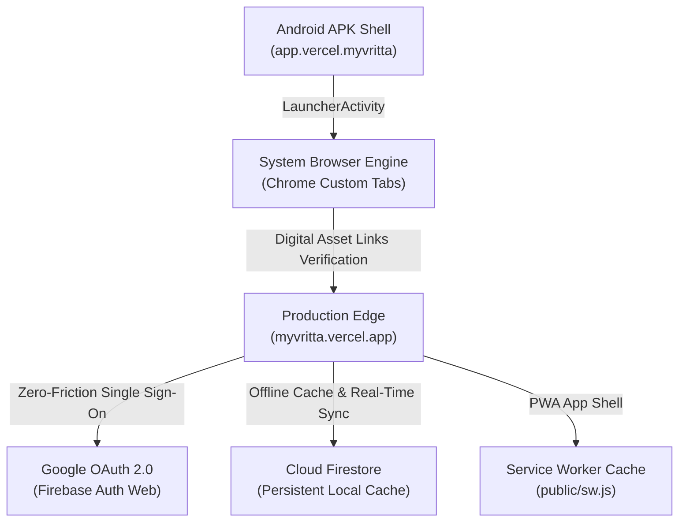

# Vritta Android Packaging & Distribution Guide

**Document Role:** How-to & Operations Guide (Diátaxis)  
**Architecture:** Trusted Web Activity (TWA) with Google Android Browser Helper  
**Target Platform:** Android 5.0+ (API 21 to API 35+)  
**Application ID:** `app.vercel.myvritta`  
**Production Origin:** `https://myvritta.vercel.app`  

---

## 1. Architecture Overview

Vritta packages its Progressive Web Application into a native Android APK using Google's **Trusted Web Activity (TWA)** protocol powered by `com.google.androidbrowserhelper:androidbrowserhelper`.



### Why Trusted Web Activity (TWA) Over Capacitor?
- **Flawless Google Authentication:** Capacitor's embedded Android WebView triggers Google's `403: disallowed_useragent` restriction when invoking `signInWithPopup`. TWA runs inside Chrome/Custom Tabs, fully supporting Google OAuth out of the box with zero code changes.
- **Instant Updates:** Updates pushed to `myvritta.vercel.app` are immediately reflected in the installed Android app without recompiling or distributing a new APK.
- **Web Platform Fidelity:** High-precision Web Audio API procedural synthesis and Web Worker timers run natively in the optimized browser engine.
- **Minimal Code Footprint:** Zero architectural divergence; web and Android share the exact same codebase, tests, and deployment pipeline.

---

## 2. Android Project Structure

The native Android project is located under `android/`:

```
android/
├── app/
│   ├── build.gradle                 # Module configuration, SDK versions & signing
│   ├── proguard-rules.pro           # Optimization & keep rules
│   └── src/main/
│       ├── AndroidManifest.xml      # LauncherActivity & Intent filters
│       └── res/
│           ├── drawable/            # Splash screen layer-list
│           ├── mipmap-*/            # Generated launcher & round icons (all densities)
│           ├── values/              # Brand colors, strings & theme styles
│           └── xml/filepaths.xml    # FileProvider content paths
├── build.gradle                     # Top-level Gradle configuration (AGP 8.6.0)
├── gradle.properties                # JVM memory and AndroidX flags
├── gradlew.bat                      # Windows Gradle wrapper
├── keystore/                        # Production & debug release keystore
└── settings.gradle                  # Root project settings
```

---

## 3. Build & Generation Commands

### Prerequisites
- **Android SDK:** Installed with Build-Tools `34.0.0` or `35.0.0` and Platform `android-35`.
- **JDK:** OpenJDK 17 or OpenJDK 21 (e.g., Android Studio bundled JBR).

### Building APKs via npm
From the `web/` directory:

```bash
# Compile Debug APK
npm run android:build

# Compile Signed Release APK
npm run android:release
```

### Building APKs via Gradle CLI
From the `android/` directory:

```powershell
$env:JAVA_HOME = "C:\Program Files\Android\Android Studio\jbr"
$env:ANDROID_HOME = "C:\Users\manis\AppData\Local\Android\Sdk"

# Debug APK
.\gradlew.bat --no-daemon assembleDebug

# Release APK
.\gradlew.bat --no-daemon assembleRelease
```

### Generated APK Locations
- **Debug APK:** `android/app/build/outputs/apk/debug/app-debug.apk`
- **Release APK:** `android/app/build/outputs/apk/release/app-release.apk`

---

## 4. Digital Asset Links Verification (Full-Screen Standalone)

To remove the browser URL address bar in production, the Android app's signing certificate SHA-256 fingerprint must be verified against `https://myvritta.vercel.app/.well-known/assetlinks.json`.

The file is committed at `web/public/.well-known/assetlinks.json`:

```json
[
  {
    "relation": ["delegate_permission/common.handle_all_urls"],
    "target": {
      "namespace": "android_app",
      "package_name": "app.vercel.myvritta",
      "sha256_cert_fingerprints": [
        "6C:2C:5D:84:B4:80:28:8B:CA:4B:CD:5B:A0:E6:13:D4:A8:6F:48:C5:F5:B2:9F:40:50:A0:BF:18:17:B6:DF:61"
      ]
    }
  }
]
```

### Deployment Verification
After deploying to Vercel, verify that the statement resolves with HTTP 200:
```bash
curl -i https://myvritta.vercel.app/.well-known/assetlinks.json
```
Once deployed, Chrome validates the relationship and renders Vritta as an edge-to-edge, full-screen standalone application.
